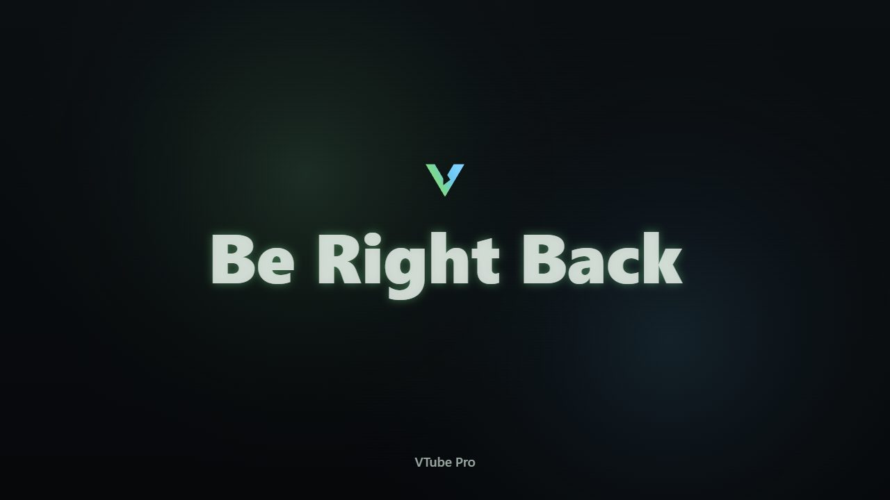
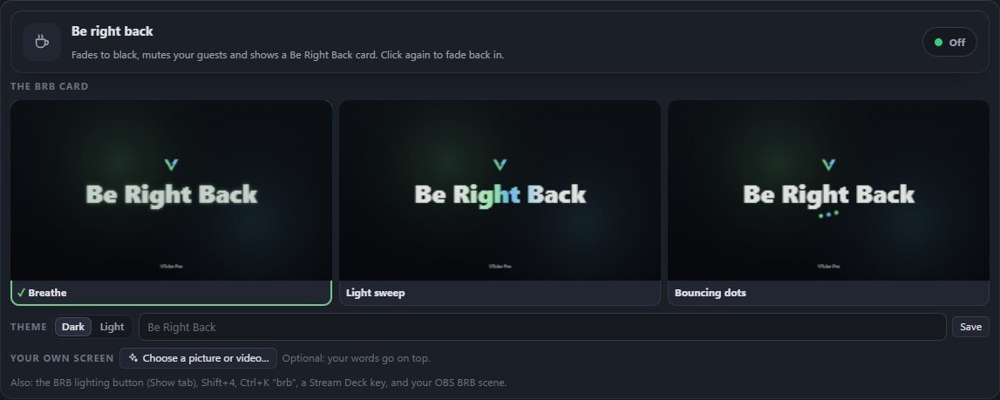
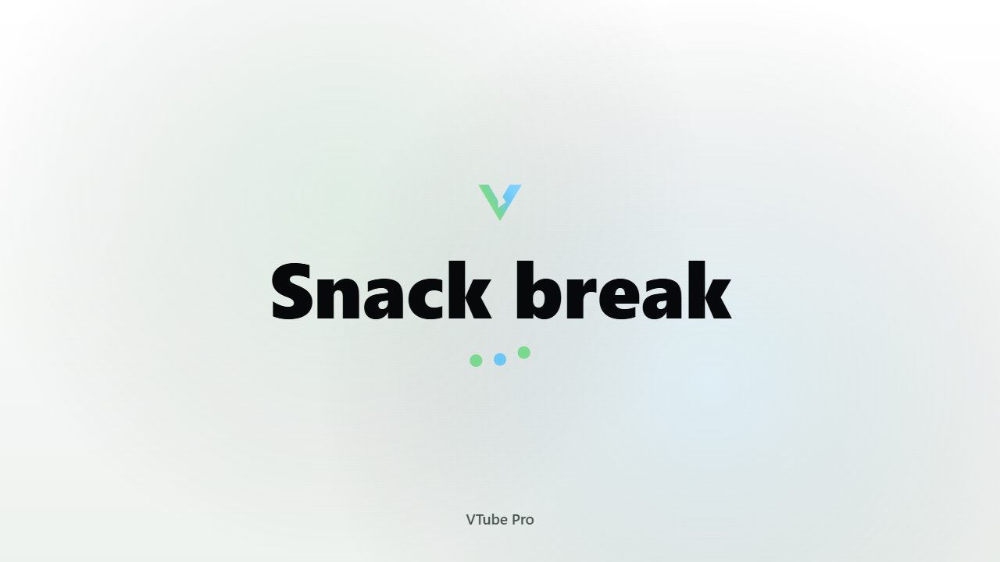
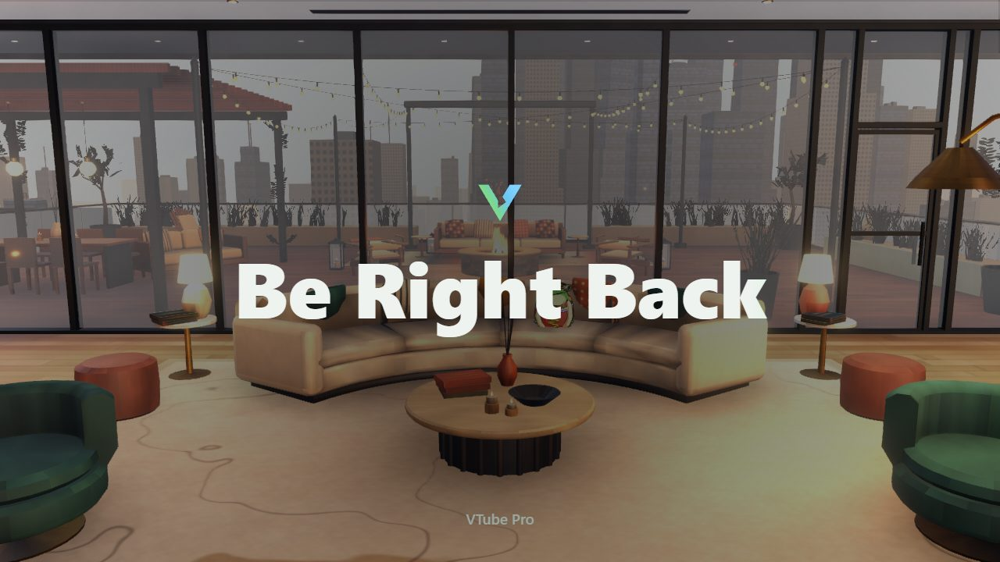

# BRB screens

Taking a break? **Be right back** hides the show for you. One click does three things:

1. The picture fades to black (about one second).
2. Your **BRB card** appears on the black and plays on a loop.
3. Your guests go quiet. Viewers don't hear them, and they don't hear each other.

Click it again to come back. The card goes, the show fades in from black, and your guests can be heard again.

## Turn BRB on and off

Any of these works. BRB is on while your lighting is **BRB**, so they all do the same thing.

- In **Live** → **Privacy**: click **Be right back**. Click it again to come back.
- In **Live** → **Show** → **Lighting**: click **BRB**. Click **Show** to come back.
- The **BRB** button on the quick bar, or on the on-air bar at the top of other areas.
- On your keyboard: **Shift+4**. **Shift+2** brings back your **Show** lights. (These keys work while you're in a
  room. The buttons work anywhere.)
- Search (**Ctrl+K**): type *brb*.
- A Stream Deck key: the **Lighting state** action set to **BRB**.
- The Live pop-out: the same buttons.

While BRB is on, the top of the Live panel says *Lights: BRB*, with a *BRB card up* chip next to it. The program
picture shows the black and your card, just like your viewers see it.

### What happens to your guests

- While BRB is on, every guest is muted: on stream, in your speakers and in the other guests' ears. Guests who join
  during the break are muted too.
- When you come back, everyone is exactly as you left them. A guest you had muted yourself stays muted.
- Guests who talk to you in Discord aren't muted by VTube Pro. Mute them in Discord if you need to.

## Pick your card

Go to **Live** → **Privacy** → **The BRB card**.

1. Pick an animation. The three cards play right there, so you see what viewers will see. Click one to use it.
   **Preview** under a card plays it once, only for you.
   - **Breathe**: the words glow in and out, slowly.
   - **Light sweep**: a soft light moves across the words.
   - **Bouncing dots**: three dots bounce under the words, like someone is typing.
2. Pick **Dark** or **Light**.
3. Type your own words, for example *Snack break*, and click **Save** (or press **Enter**). Up to 40 characters.
   Leave it empty for *Be Right Back*.

Your choice is saved, and every OBS page uses it.

## Make your own BRB screen

Want your own art behind the words? Use a picture or a short looping video.

1. Make your picture or video. It can be:
   - a picture: PNG, JPG, WebP or GIF;
   - a short video loop: MP4 or WebM.

   Keep it under 40 MB. Make it wide, like your stream: 1920 × 1080 looks sharpest. The picture fills the whole
   screen, so a different shape gets its edges cut off. It is never stretched.
2. Go to **Live** → **Privacy** → **The BRB card**.
3. Next to **Your own screen**, click **Choose a picture or video…**.
4. Pick your file. That's it.

Your picture or video now sits behind the words, with a soft veil so the words stay easy to read.

- You don't need to put the file anywhere special. VTube Pro keeps a copy on your computer. It is never uploaded to
  the internet.
- VTube Pro keeps one screen. To use another, click **Change…** and pick the new file. It replaces the old one.
- Videos loop and always play without sound, so nothing surprises your viewers.
- The animation, the theme and your words still apply on top of your picture.
- To go back to the plain card, click **Remove**.
- Your own screen file is kept on your computer. The built-in
  cards work without it.

If the file is too big, or isn't a picture or video VTube Pro can show, the studio tells you what to use instead.

## Stream Deck and search

- **Lighting state** → **BRB** turns the break on. **Show** ends it.
- **BRB card look** changes the card. Pick an animation, **Dark** or **Light**, or new words. A key with no other
  choice switches between **Dark** and **Light**.
- In search (**Ctrl+K**), try *brb light*, *brb dark* or *brb dots*.

## OBS

You don't need a special OBS scene. Every OBS page that shows VTube Pro fades to black and shows the card by itself.

If VTube Pro switches your OBS scenes, the **BRB** lighting also switches OBS to your BRB scene (while you're in a
room). To set that up, go to **Live** → **OBS** → **Set up OBS automation**.
