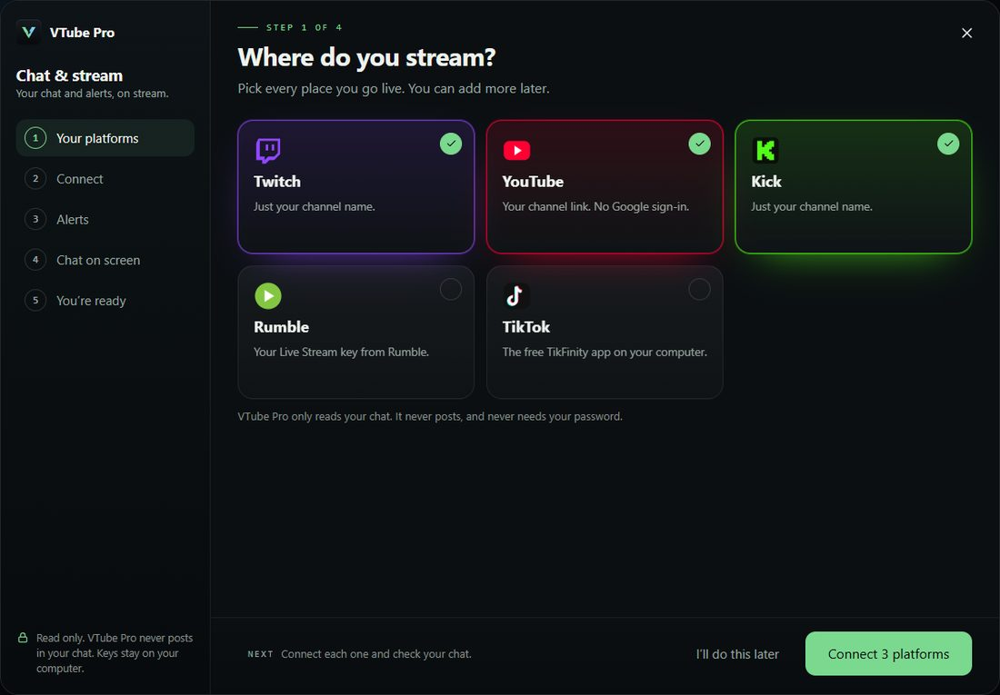
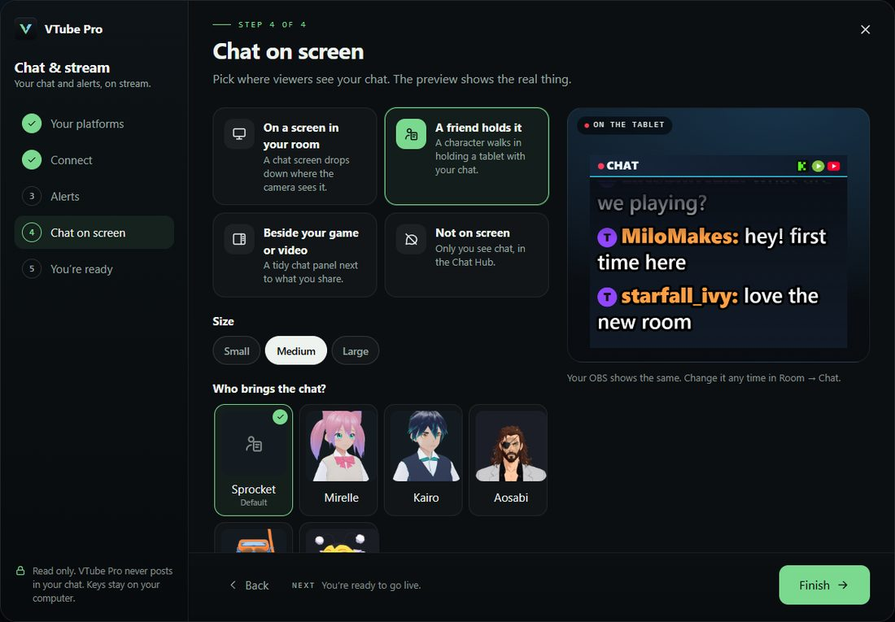

# Your chat & stream

Bring your Twitch, YouTube, Kick, Rumble or TikTok chat into VTube Pro. Your viewers see chat and alerts on stream.
You see everything in one big window, the Chat Hub. It takes about 3 minutes.

VTube Pro only **reads** your chat. It never posts, never moderates, and never needs your password.

## Set up my chat & stream

A short guided set-up connects your chat, tries your alerts and puts chat on screen. Open it from any of these:

- **Home**: the chat light → **Set up chat**.
- **Live** → **Chat & polls** → **Set up chat & alerts**.
- **Tracking** → **Chat & donations** → **Set up my chat & stream** (it says **Change my chat set-up** once you're
  connected).
- **Chat** in the left rail, while nothing is connected: **Set up my chat**.
- **Settings** → **Guided set-ups** → **Set up my chat & stream**.
- The last screen of the first-time setup, or of a room set-up.

There are four steps (*Step 1 of 4* at the top). Close it any time: it opens at the first step that isn't done yet.
Every screen is described below.

### Step 1: Your platforms

*Where do you stream?* Click every place you go live, then press **Connect** (for example **Connect Twitch** or
**Connect 2 platforms**). You can add more later, or press **I’ll do this later**.

| Platform | What you need |
|---|---|
| Twitch | Just your channel name. |
| YouTube | Your @handle or channel link. No Google sign-in. |
| Kick | Just your channel name. |
| Rumble | Your Live Stream link from Rumble. |
| TikTok | The free TikFinity app on your computer. |

### Step 2: Connect

One platform at a time. Type your name (a link works too) and press **Connect** (for example **Connect Twitch**).

On the right is **Your chat**. Say hi in your own chat. When your message shows up, the screen says
**I can see your chat ✔**. Now you know it works.

- **Send a test message** shows a pretend message, marked TEST. Only you and your OBS see it. It never reaches your
  real chat.
- **YouTube and Rumble** only have chat while you're live. The screen says **Connected ✔**, and your chat shows up
  when you go live. TikTok says **TikFinity is connected ✔**.
- **Rumble** gives you a private link. Open Rumble's Live Stream page, copy the whole link, and paste it in. It
  stays on your computer, and it's never shown again.
- **TikTok** doesn't share LIVE chat with other apps. The free **TikFinity** app does it for you: open it, connect it
  to TikTok, then press **Find TikFinity**.
- **Change** fixes a name. **Disconnect** turns a platform off.
- Done with one? Press **Next: …** for the next platform, or **Set up alerts**. Stuck? **Skip for now** (or
  **Skip to alerts**) moves on.

If something is wrong, the screen says what to do in one sentence:

| You see | Do this |
|---|---|
| We couldn't find that channel | Check the spelling, then press **Try again**. |
| Rumble didn't accept that link | Copy the whole link again from Rumble. |
| We can't see TikFinity | Open TikFinity on this computer, then press **Try again**. |
| We can't reach Twitch right now | Check your internet, then press **Try again**. |

### Step 3: Alerts

*Your alerts.* Viewers see a big card when someone supports you. Press **Try it** next to each one to see it:

- **New followers**: a thank-you line in your chat.
- **Subs & members**: a big card for every new sub or member.
- **Gifted subs**: one card for a whole gift, with the gifter's name.
- **Raids**: a card when another streamer sends their viewers.
- **Tips & donations**: Bits, Super Chats, Kicks, Rants and gifts.

Each line says which of your platforms sends it. Twitch's public chat shares subs, gifted subs, bits and raids, but it
does not share new followers or **channel-point redeems** (Twitch only tells apps that sign in). VTube Pro asks for no
sign-in anywhere, so those two are not shown for Twitch.

- **Big alerts for tips**: **Every tip**, **$1 and up**, **$5 and up** or **$10 and up**.
- **Big alerts for new subs and members**: on or off.
- **Where alerts show** in a room: **Support board** (a glowing board), **On the chat screen**, or **Off**. Every alert
  also waits in the Chat Hub until you thank them.

Tests show only on your computer and your OBS. They never reach your real chat.

### Step 4: Chat on screen

Pick where viewers see your chat. The preview on the right is exactly what your stream shows.

- **On a screen in your room**: a chat screen drops down where the camera sees it.
- **A friend holds it**: a character walks in holding a tablet with your chat. Pick who under
  **Who brings the chat?**. Any of your avatars works, even your own.
- **Beside your game or video**: a tidy chat panel next to what you share.
- **Not on screen**: only you see chat, in the Chat Hub.

The first two need a room. Without one they say *Shows when you’re in a room*.

Then pick a **Size** (**Small**, **Medium** or **Large**), **Which side** for the chat screen (**Left**,
**Best spot** or **Right**), and whether to **Hide bots and !commands**. Press **Finish**.

You can change this any time under **Chat** in the left rail, or run the set-up again.

### You're ready ✔

The last screen shows each platform, your alerts and where chat shows. Each has a **Change** or **Fix it** button.
Everything is saved on your computer and reconnects by itself every time you go live. **Open Chat Hub** shows every
message in one window. **Back to the studio** closes the set-up.

Setting your **stream title and category** from VTube Pro is coming soon. Set them on your platform for now.

## Choose where your chat is

Go to **Chat** in the left rail (or press **Move chat** in the **Live** panel). At the top:

- **Where does the chat show?** **On screen** (a chat box over your stream), **In the room** (a chat screen inside
  your 3D room), **Both** (the room's chat screen, and the box whenever a shot doesn't see that screen) or **Hidden**.
- **Chat box on stream** shows your stream's live picture with the chat box on it. **Drag the box** where you want it
  and pull any corner to resize it. It snaps to the edges and the middle (hold **Alt** to place it freely). Or click a
  corner, a side or **Auto** (VTube Pro finds free space beside you, never over a face).
- **Applies to**: **Every room**, **This room** or **Only in** the show mode you're in (Talk, Interview, Gaming …).
  A room or mode with its own place keeps it; everything else uses the every-room place. **Use this place everywhere**
  makes one place for all rooms again.
- The line under the picture always says which place your stream uses right now. If a room's custom layout (Show →
  Layout editor) placed the chat earlier, it says so, with **Use my place here**.

Your OBS and your party guests' OBS show the box where you put it as soon as you let go.

## Emotes and emote sounds

VTube Pro reads the emotes of the channels you connected by itself: your **Kick** channel's emotes, **7TV**,
**BetterTTV** and **FrankerFaceZ** emotes (Twitch, Kick, YouTube). Twitch's own channel emotes and YouTube member emoji
have no public list here, so they appear once someone uses them in your chat. Emotes show in your chat box, the chat screens in your room and the Chat Hub, and animated ones
move. The lists refresh every 30 minutes, or press **Refresh**.

**Chat** → **Emotes & emote sounds** lists them: **Your channels**, **Used this stream** (how often each one was used),
**With a sound**, **Everyone's** and **Seen in chat**, with a search box.

**Emote sounds are off until you turn them on.** To give an emote a sound:

1. Click the emote, then **Give this emote a sound**.
2. Pick a built-in sound (Air horn, Ding, Boing, Ta-da …) or **Add your own sound…** (an .mp3, .ogg, .wav, .m4a,
   .webm or .flac file up to 3 MB; it stays on this computer).
3. Set its **Volume** and how long to **Wait** before it can play again. **Only when several people use it** makes it
   a hype sound: it plays once enough different people used the emote within the time you set.
4. **Test (only me)** plays it on your **Only me** output (Audio mixer), not on your stream.
5. Turn on **Play a sound when chat uses an emote** at the top.

**More emote sound settings**: the gap between any two sounds, sounds per message, how soon the same person can set
off another one, at most N sounds per 10 seconds, a pause while a raid floods chat, subscribers / members only, and
**Ignore bots**. Emote sounds play in your studio window like every show sound (see [Sound on your stream](SOUND.md));
the Stream Deck action **Emote sounds on / off** and the **Live** panel's **Emote sounds** button switch them.

## The Chat Hub

One big, easy-to-read window for you: every chat in one feed, plus a list of **support** (tips, Super Chats, Rants,
Kicks, bits, subs, gifts, memberships, TikTok gifts) and **stream events** (raids, hosts, follows, shares).

Open it from **Home** → **Chat Hub**, **Room** → **Chat** → **Open Chat Hub**, or the **Live** panel. It is an ordinary
window, so drag it to a second monitor.

- **✓** marks an event as done. **Thank on stream** plays its alert again on stream.
- Filters: Money, Subs, Raids, Follows, Other, Unread only, and one chip per platform.
- Chat: text size A− / A+, hide bots and !commands, highlights only, pin up to 5 messages, star a person.
- Keys in the hub: A done next · T thank next · S skip · R replay · + / − text size.

### Read donations aloud (off until you turn it on)

A voice can read supporters' messages. It plays in your **studio window**, through the Audio mixer's *Read-aloud* row
(its own meter and volume), never on the OBS page: your stream hears it from the studio, like your guests. Keep the
studio open. (The Chat Hub window no longer plays it, so it is never heard twice.) You pick the smallest amount, which platforms, the voice, its speed and volume. Swear words can be bleeped and
links are read as "link". Skip and Replay are always one click away. This uses your computer's own voices (Windows), or the free Kokoro voice below.

### Kokoro voice (optional, free, on this computer)

**Voice** → **Kokoro (free, natural)** reads with Kokoro-82M, a natural-sounding open voice model that runs on your own PC.
It needs no account and no key. The first time, press **Install the Kokoro voice** (about 110 MB plus a small private
Python runtime, from the official sources with checksums, into the VTube Pro folder; nothing downloads until you press
it). Pick one of 8 American-English voices and a speed. The line is made by VTube Pro, played through the studio's
mixer like every other read-aloud line, and **Test voice** works the same. If Kokoro isn't installed or hiccups, your
computer's voice reads that line instead (one note says so) and Kokoro rests for 30 seconds before it is tried again.
Viewer names the voice doesn't know are spelled out letter by letter rather than skipped; accents, Japanese kana, Cyrillic and
Greek names are read (ナイト, Привет, José), and words in scripts it has no table for (Chinese, Korean, emoji) are skipped quietly. A line
with nothing it can say is skipped, with no error message. Details and licences:
[LIVE_CAPTIONS.md](LIVE_CAPTIONS.md).

## Stream Deck and other tools

- **Stream Deck**: the hub's **Stream Deck & tools** button lists ready-made web addresses for done next, done all,
  thank next, skip, replay and read-aloud on / off. Add each as a Stream Deck **Website** action. **Emote sounds on /
  off** is in the Stream Deck & controllers screen (Chat Hub group).
- **Streamer.bot and scripts** on this computer can send events in too (details below).

## What Twitch shows

VTube Pro reads Twitch through its public chat as an anonymous reader: no account, no sign-in, no token. That already
gives chat, emotes, bits (cheers), new subs and resubs, gifted subs (a mystery gift becomes one attributed event),
raids, announcements and deleted messages. Twitch does not send **new followers**, **channel-point redeems**, hype
trains or ad breaks to the public chat (only to apps that sign in), so those are not shown. Nothing is ever sent to your
chat.

## For the curious: how each platform connects

| Platform | What you give | How VTube Pro reads it | Sign-in or key? |
|---|---|---|---|
| Twitch | channel name or twitch.tv link | Twitch's public chat as an anonymous reader: chat, emotes, bits, subs, resubs, gifted subs (mystery gifts become one attributed event), raids, announcements, deleted messages | No. Follows and channel-point redeems are not part of Twitch's public chat, so they are not shown (see "What Twitch shows"). |
| YouTube | @handle, channel link or live link | the public live chat of the watch page; finds your live stream by itself | No Google sign-in, no quota |
| Kick | channel name or kick.com link | Kick's public chat socket: chat, Kicks, subs, gifted subs, hosts, follows, 7TV emotes | No |
| Rumble | the whole Live Stream link (rumble.com → Account → Live Stream API) | polls Rumble's Live Stream API every few seconds: chat, Rants, subs, gifted subs, followers | Yes: your own link. It is a secret: kept in `config/chat.json` on your computer, never returned or shown |
| TikTok | your @name (optional) | TikTok has no public LIVE chat. VTube Pro reads TikFinity's local connection (`ws://localhost:21213/`) or any tool that speaks the same format: chat, gifts (combos counted once), follows, shares, subscriptions, optional likes and joins | TikFinity running and connected to TikTok |

**Keys never go through a website.** The Rumble link can also be added on VTube Pro's own page
`http://127.0.0.1:5191/chat/connect` (this computer only, never framed). VTube Pro refuses it from any web page
(`server/chat/connectPage.ts`: `403 {code:'local-only'}` for `rumble.apiKey`, `clearRumbleKey` and connector
address overrides).

### Routes (this computer)

- `GET /api/chat/status` per-platform state (`off`, `connecting`, `live`, `waiting`, `error`) · `GET /api/chat/recent`
- `GET|PUT /api/chat/config` (no secrets in answers) · `POST /api/chat/test {what, platform?}` (a local test event:
  your OBS and preview only, never sent, never counted, never relayed to party guests)
- `POST /api/chat/ingest {platform, kind:'chat'|'finance'|'event', user, text, fkind, amount, currency, usd, ev, id}`
  for Streamer.bot, TikTok tools that can only send web requests, and scripts
- `GET /api/chathub/do/<action>?key=<per-computer key>` for Stream Deck: `ack-next`, `ack-all`, `thank-next`, `skip`,
  `replay`, `tts-on`, `tts-off`, `tts-toggle`. `POST /api/chathub/do/<action>` works without the key from this computer.

### Files

`shared/streamSetup.ts` (the set-up's logic: inputs, the "I can see your chat" verdict, alerts, steps),
`src/ui/streamSetup/*` (the set-up), `server/chat/connectPage.ts` (the secrets guard and `/chat/connect`),
`shared/chat.ts`, `shared/chathub.ts`, `server/chat/*` (connectors, the hub, the events queue, read-aloud),
`chathub.html` + `src/chathub/*` (the Chat Hub window), `src/audio/mixer/showSounds.ts` (read-aloud playback in the studio).
Read-aloud voices: `server/chat/readAloudVoice.ts` (which voice reads: this computer's or Kokoro, and the fallback),
`src/chathub/voice.ts` (the voice choice).

### Testing

`npx tsx tools/stream_setup_unit.ts`: the set-up's logic, its words against the voice rules, the secrets guard, the
connect page, and the real chat routes with the real Twitch connector against a mock Twitch chat server.
`tools/stream_setup/harness.html` runs the whole set-up on mock platforms (no server, no network):
`?step=connect&platform=twitch&mode=web&preset=twitch-live`.

