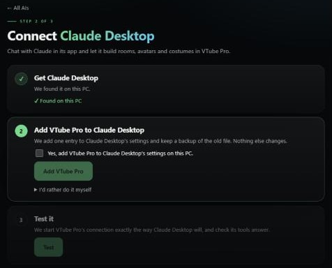

# Make a model with Claude or Codex

Ask Claude or Codex to build 3D things for your stream: characters, outfits, accessories and rooms. This
guide shows every step, with prompts you can copy.

Three words first:

- A **model** is a 3D thing: a character (your avatar), an outfit, an accessory or a room.
- A **prompt** is the message you type to the AI.
- A **terminal** is a window where you type a command and press Enter. You only need one for Claude Code and Codex.

**Where to start:** open the studio (double-click `Start VTube Pro`; it opens at http://127.0.0.1:5191/). Click **Create** in the menu down the left side. Then
pick **I use the Claude, ChatGPT or Grok app**. It's the one marked **Recommended**.

The short version is in [AI connectors](AI_CONNECT.md). This page goes step by step.

---

## What this does

You chat with Claude or Codex in its own app. The free VTube Pro gives that app a set of VTube Pro tools. The
AI uses them to build on your computer. It mostly uses Blender, a free 3D program. VTube Pro asks for no account and
no key, and adds nothing to your bill. Big steps wait for your OK in VTube Pro. What it makes stays on your
computer and shows up in your studio.

Good to know before you start:

- AI apps do best with **mascots, creatures, robots, props and rooms**.
- For a **human or anime character**, start in VRoid Studio (free) instead. Then your AI can help you improve it. See
  [What it can make](#what-it-can-make).
- The AI writes instructions for Blender. Results vary. Expect to ask for a few changes.

## What you need

- **VTube Pro running** on your computer (`Start VTube Pro`). Nothing else to download: VTube Pro itself is what
  connects to your AI app.
- **Chrome, Edge or Firefox** for the studio.
- **One AI app:** Claude Desktop, the ChatGPT desktop app, Claude Code or Codex. Log in with your Claude or ChatGPT
  account.
- **The best model you can pick.** Opus 5.5 and GPT-6.1 are the ones we tested. If your app doesn't show them, pick
  the best model you see. The steps are the same.
- **Blender** (free, about 400 MB). In the studio, open **Tracking** → **Tools & add-ons**, find **Blender** and
  press **Install**.
- About 10 minutes for the first setup.

Nice to have, not needed:

- **ComfyUI**, a free picture AI on your computer, for posters, skies and overlays. It needs a strong graphics card.
  See [ComfyUI workflows](COMFYUI.md).
## Pick your app

Every app gets the same VTube Pro tools. The difference is where you type.

| | **Claude Desktop** | **ChatGPT desktop app** | **Claude Code** | **Codex** |
|---|---|---|---|---|
| What it is | The Claude app | The ChatGPT app (not the website) | Claude in a terminal or code editor | OpenAI's Codex in a terminal or code editor |
| Good for | Just chatting. Easiest. | Just chatting, with a ChatGPT login | People who don't mind a terminal | People with a ChatGPT login who don't mind a terminal |
| Model to pick | **Opus 5.5** | **GPT-6.1**, if your app shows it | **Opus 5.5** | **GPT-6.1** |
| Log in with | Your Claude account | Your ChatGPT account | Your Claude account | Your ChatGPT account |
| Needs a terminal? | No | No | Yes | Yes, or a code editor |

Not sure? Have Claude: pick **Claude Desktop**. Have ChatGPT and don't want a terminal: pick the **ChatGPT desktop
app**. Claude Desktop is made for Windows and Mac only. On Linux, pick Claude Code or Codex.

**Grok Build** works too. It's xAI's coding app for the terminal, and it connects the same way. **Grok Bot**, the Grok
app, works as well: it runs in the cloud, so it connects through VTube Pro's internet bridge instead. Its row on
**Create** shows the steps.

**LM Studio** works too, with a free AI on your own computer. It needs no account. Pick a big model that can use
tools: small models make simpler things.

### Never used a terminal?

A terminal is a window where you type a command and press Enter. Claude Code and Codex run in one. You start them
inside a folder, and they work with the files in that folder.

- **Open a terminal in a folder on Windows:** open the folder in File Explorer. Right-click an empty spot and pick
  **Open in Terminal**.
- **On a Mac:** in Finder, right-click the folder and pick **New Terminal at Folder**. Not there? Open **Terminal**
  from **Applications** → **Utilities**. Type `cd` and a space, drag the folder into the window, then press Return.
- **Don't have Claude Code or Codex yet?** On **Create**, open its row and use the **Get Claude Code** or
  **Get Codex** link. It shows you how to get it.
- **Prefer no terminal?** Use Claude Desktop, or the ChatGPT desktop app with GPT-6.1.

## Connect it (one time)

1. Open the studio (`Start VTube Pro`) and click **Create** in the menu down the left side.
2. Nothing to install first: VTube Pro on your PC does the connecting. (If a card at the top says something needs
   doing, press its button and follow it until the card goes away.)
3. Under **How do you use AI?**, pick **I use the Claude, ChatGPT or Grok app**.
4. In **Connect your AI app**, click your app's row: **Claude Desktop**, **Claude Code**, **ChatGPT Desktop**,
   **Codex**, **Grok Build** or **LM Studio** (new in beta.12: **Cursor**, **VS Code** with Copilot, and **Gemini
   CLI**). The row opens into 4 short steps.

5. Don't have the app yet? Use the **Get** link in step 1 of the row. Get it and log in.
6. Press **Connect**. VTube Pro opens a page in a new tab, like **Connect Claude Desktop**.
   - The browser blocked the tab? Allow pop-ups for this page (127.0.0.1), then press **Connect** again.
7. In that tab, at **Add VTube Pro to …**, tick the box. It says, for example,
   **Yes, add VTube Pro to Claude Desktop's settings on this PC.** Then press **Add VTube Pro**. (Connected before?
   The button says **Add it again**.) VTube Pro backs up the app's settings first. Nothing else changes.

   

8. Restart your app:
   - **Claude Desktop** or **ChatGPT:** quit the app fully (also from the tray or menu bar), then open it again.
   - **Claude Code**, **Codex** or **Grok Build:** start a new session.
   - **LM Studio:** nothing to restart. It loads VTube Pro by itself. It asks before each tool call: allow it once,
     or always.
9. Back in **Create**, press **Test the connection**. You see **VTube Pro's 33 tools are ready** (the number may
   change). The row's chip turns **Connected**.
10. Start a new chat in your app and paste this first:
    *"I have VTube Pro installed. Find it and connect, so I can create with it."*
    It finds VTube Pro's tools, checks the link and tells you what it can make. Then ask for anything.

Codex and the ChatGPT desktop app share one settings file. Connecting one connects both.

**Want it all set up in one go?** VTube Pro's **Tools & add-ons** page has **Set up AI creation** at the top: it finds
Blender (or offers to install it), adds VTube Pro to every AI app you pick, shows exactly what it writes (with a backup
first) and checks that it all works.

**Check it from the app.** Ask your AI: *"Use VTube Pro to show me my avatars."* It lists them. In Claude Code or Codex,
you can also type `/mcp`: **vtube-pro** is in the list.

## Pick the model

**Opus 5.5** is a Claude model, made by Anthropic. **GPT-6.1** is an OpenAI model. Which models you see depends on
your app.

**Effort** means how long the AI thinks before it acts. Higher effort is slower.
For building, **high** is a good start.

Every prompt in this guide works the same with Opus 5.5 and GPT-6.1.

### Opus 5.5 in Claude Desktop

1. Start a new chat.
2. Pick **Opus 5.5** in the app's model menu. The menu shows the name of the model you're using now.
3. If the menu has an effort or thinking option, pick **high**. If it doesn't, skip this. Opus 5.5 works fine as it
   is.
4. Don't see Opus 5.5? Pick the strongest model your app has.

### Opus 5.5 in Claude Code

Start Claude Code with Opus 5.5:

```text
claude --model opus
```

In current versions, `opus` means Opus 5.5. The full name works too: `claude --model claude-opus-5-5`.

- Already in a session? Type `/model` and pick **Opus 5.5**.
- To think harder, add effort: `claude --model opus --effort high`. The levels are low, medium, high, xhigh and max.

### GPT-6.1 in the ChatGPT desktop app

1. Start a new chat.
2. Pick **GPT-6.1** in the app's model menu, if your app shows it.
3. If the menu has a thinking or effort option, pick the higher one for building.
4. Don't see GPT-6.1? Pick the strongest model your app has.

### GPT-6.1 in Codex

Codex may list GPT-6.1 as **GPT-6.1-Sol**. Its short name for commands is `gpt-6.1-sol`.

- **In a session:** type `/model`. Pick **GPT-6.1-Sol**, then pick the reasoning effort. Pick **high** for building.
- **When you start it:** `codex -m gpt-6.1-sol -c model_reasoning_effort=high`
- **In your code editor:** pick it in Codex's model menu.

The list of models comes from OpenAI and can change. The typed `codex` commands need Codex for the terminal. New to
terminals? See [Never used a terminal?](#never-used-a-terminal).

**Keep it every time (optional, for people who like settings files).** Skip this if you're new: `/model` works every
time. Codex keeps its settings in a file called `config.toml`, in a hidden folder called `.codex`:

- **Windows:** `C:\Users\<your name>\.codex\config.toml`. Open it with Notepad.
- **Mac:** in Finder, press Shift+Cmd+G, type `~/.codex` and press Return. Open `config.toml` with TextEdit.

At the very top of the file, above the first line in [square brackets], it should say:

```toml
model = "gpt-6.1-sol"
model_reasoning_effort = "high"
```

If a `model =` or `model_reasoning_effort =` line is already there, change it. **Don't add a second one**: a doubled
line breaks the file, and Codex and ChatGPT stop loading. Leave the lines from `# Added by VTube Pro` and
`[mcp_servers.vtube-pro]` as they are. They are your VTube Pro connection.

### No AI app yet?

That's the other answer under **How do you use AI?**: **I don't have an AI app**. You can get an app, or chat right in
**Create** with a free model that runs on your own computer (see [Local AI](LOCAL_AI.md)). A small model is not as
strong as Opus 5.5 or GPT-6.1, so expect simpler results.

## Your first build in 5 steps

Build when you're not live. Building uses a lot of your computer's power.

1. **Open your app and pick the model.** See [Pick the model](#pick-the-model).
2. **Paste a small first prompt.** This one is a good start:

   ```text
   Use VTube Pro to make me a new avatar: a small round robot with a screen for a face,
   two short antennae and stubby arms. Soft pastel blue and white. Build it in Blender and
   save it as a new avatar called "Bolt". Keep it under 37,000 triangles. Show me pictures
   from the front, the side and the back when it's done.
   ```

   **Triangles** are the tiny flat pieces every 3D model is made of. Fewer triangles keep your stream smooth. 37,000
   is a safe limit for VTube Pro.

3. **Say yes twice.**
   - Your app may ask if it can use a VTube Pro tool. That's the app's own question. Allow it.
   - Then VTube Pro asks for your OK to run Blender. On Windows, a page called **AI connectors** opens in your
     browser by itself. It says your app wants to run **blender_run_python**. Press **Approve once**.
   - No page opened? In the studio, open **Create** and press **Check what Claude made**. Press **Review**. Or, if you
     see **Open the list in VTube Pro**, press it and scroll up to **Approvals**.
   - You have **5 minutes**. After that it counts as No. See
     [What waits for your OK](#what-waits-for-your-ok-and-why).
4. **Wait a few minutes.** Blender works in the background. No Blender window opens. Your AI tells you in the chat when
   it's done.
5. **Look at it.** Open **Me**. Your new avatar is a tile under **Your avatar**. Careful: clicking a tile shows it on
   your stream right away. Then click it to wear it.

Don't see the tile? Reload the studio page. Its arms don't move? See the auto-rig prompt in
[Example prompts](#avatars).

Now ask for **one change at a time**. *"Make the antennae twice as tall. Keep everything else the same."*

## What it can make

| You want | What your AI does | You also need |
|---|---|---|
| A mascot, creature, robot or prop character | Builds it in Blender and saves it as a new avatar | Blender |
| A human or anime character | Best made in VRoid Studio, then added with **Add my model**. Your AI can look at it and suggest fixes. | VRoid Studio (free) |
| An outfit | Builds it on your avatar's skeleton, so it moves with you, and adds it | Blender |
| An accessory (glasses, hat, held item) | Same as an outfit, marked as an accessory so it layers on top | Blender |
| A room | Builds it in Blender and saves a room file. You add it with **＋ Add my room**. | Blender |
| A poster, sky, thumbnail or overlay picture | Sets up a ready-made ComfyUI recipe. You press **Run** in ComfyUI. | ComfyUI and a strong graphics card |
| A check of your avatar or room | Takes pictures of your avatar, and runs the room check on a room | Blender, for avatar pictures |

A **skeleton** (or **rig**) is the set of bones that makes a character move.

The **room check** is VTube Pro's built-in checker. Its tool name is `check_room`. It looks at a room file and lists
problems, like no places to sit, the wrong size, or too heavy for streaming. It only reads. It never changes the file.

VTube Pro also has its own **character maker**. It uses ComfyUI on your computer, so it needs a strong graphics card
and ComfyUI set up first. Without ComfyUI, your AI builds the thing itself in Blender. That works too. It just takes
more back and forth. Outfits are built the same way: your AI builds the outfit in Blender and VTube Pro adds it.

## Example prompts

Every prompt here works the same in Opus 5.5 and GPT-6.1. The tips under each section are the small differences.

How to use them:

- Copy a prompt. Replace the words in [square brackets] with your own, and delete the brackets too. Example:
  "[Mo]" becomes "Pip".
- Paste it into your AI app.
- Say **"Use VTube Pro"**, so the AI picks its VTube Pro tools.
- Say the avatar's or room's name exactly as it shows in **Me** or **Room**.
- Give **one job per prompt**.
- **No real brands, logos or game places.** Make your own designs.

### Avatars

```text
Use VTube Pro to make me a new avatar: a fluffy moth spirit with big feathery antennae,
round black eyes and a cream scarf. Cute chibi shape: big head, small body. Build it in
Blender and save it as a new avatar called "[Mo]". Keep it under 37,000 triangles.
```

```text
Use VTube Pro to make me a new avatar: a tiny dragon in an oversized purple hoodie, with
little wings and a round belly. Toon colours, no fine detail. Build it in Blender, save it
as a new avatar called "[Ember]", then show me pictures from 4 sides.
```

```text
Use VTube Pro to make me a mascot avatar: a coffee mug with a friendly face on the front
and curls of steam for hair. Save it as a new avatar called "[Mugsy]".
```

A new avatar your AI builds may move its head and body, but not its arms. Want the arms to move too, or plan to make
outfits for it? Ask for the auto-rig first. VTube Pro asks for your OK.

```text
Use VTube Pro's auto-rig on my avatar "[Bolt]", so its head and arms can move.
```

```text
I made a character in VRoid Studio and added it with Add my model. It's called "[Pip]".
Use VTube Pro to take pictures of it from the front, both sides and the back. Tell me 3
things that would make it look better. Don't change anything yet.
```

**Opus 5.5 tips**

- Add *"Tell me your plan in 5 short steps first. Wait for my OK."* You catch a wrong idea before Blender runs.
- In Claude Desktop, add a picture to your message for the look you want.
- In Claude Code, start with `--effort high` for a first build.

**GPT-6.1 tips**

- Check the reasoning effort says **high** in `/model`.
- In Codex, attach a picture when you start: `codex -m gpt-6.1-sol -i my-sketch.png`. Put the picture in the folder
  you start Codex in, and use its real file name.
- Give the look as a short list: shape, colours, size, style.

### Outfits

Your avatar keeps its bones. An outfit is built on the same bones, so it moves with you.

```text
Use VTube Pro to make an outfit for my avatar "[Bolt]": a yellow raincoat with big round
buttons and the hood down. Build it yourself in Blender on my avatar's own skeleton, so it
moves with me. Leave the face uncovered. Add it to my outfits, but don't put it on yet.
```

```text
Use VTube Pro to make an outfit for my avatar "[Mo]": a cozy knitted sweater with a star
pattern and sleeves that are a bit too long. Build it yourself in Blender. Add it to my
outfits as "[Star sweater]".
```

```text
Use VTube Pro to make a chef outfit for my avatar "[Bolt]": a white apron with a pocket and
a small towel tucked in the belt. Build it yourself in Blender. Add it to my outfits.
Don't put it on yet.
```

```text
Use VTube Pro to make a red version of my outfit "[Raincoat]" on my avatar "[Bolt]", as a
new outfit. Keep the old one as it is.
```

Why *"Build it yourself in Blender"*? It makes your AI write the outfit in Blender and add it as a new outfit, without
putting it on. Putting an outfit on changes your stream, so that step always asks first.

**Opus 5.5 tips**

- Add *"Check from 4 sides that nothing pokes through the body."*
- Ask it to name the outfit after what it is, like "Raincoat".

**GPT-6.1 tips**

- Keep effort on **high**. Outfits are fiddly.
- If it pokes through, ask for one fix: *"Move the sleeves out a little. Change nothing else."*

### Accessories

An **accessory** layers on top of any outfit, like glasses or a hat. You can wear several at once.

```text
Use VTube Pro to make round glasses with thin gold frames for my avatar "[Bolt]". Build
them in Blender, fixed to the head so they move with me. Add them as an accessory, not an
outfit.
```

```text
Use VTube Pro to make a crooked witch hat for my avatar "[Mo]". Fix it to the head, keep it
clear of the eyes, and add it as an accessory.
```

```text
Use VTube Pro to make headphones with little cat ears for my avatar "[Bolt]". Add them as
an accessory.
```

```text
Use VTube Pro to make a retro microphone that my avatar "[Bolt]" holds in the right hand.
Attach it to the right hand and set it so the hand closes around it. Add it as an
accessory.
```

Accessories show in **Me** as pills under **Accessories**. Click one to switch it on or off. Shows up under
**Outfit** instead? Ask: *"Mark the [glasses] as an accessory."*

**Opus 5.5 tips**

- Ask what it hangs on: *"Tell me what it's attached to."*
- Small things look better simple. Say *"bold shapes, no tiny details"*.

**GPT-6.1 tips**

- One accessory per prompt. Ask for the next one after you've seen the first.
- If the hat floats, say: *"Lower the hat until it sits on the head."*

### Rooms

**Easiest: Create → Make a room with your AI.** Describe the room, pick the **Places for people**, the screen and the
door, then press **Copy the brief** and paste it into a new chat. The brief tells your AI every name VTube Pro reads:
places to sit, cameras, the screen and the door. So the room works the first time.

Your AI builds the room and saves it as a file. You add the file with **＋ Add my room**. A **.glb** file is the kind
of room file VTube Pro opens best.

First, make a folder for your builds: in **Documents**, make a folder called **VTube Pro builds**.

```text
Use VTube Pro to build me a room: a cozy ramen shop at night. A counter with three stools,
paper lanterns, a steaming pot and a rainy window. A 16:9 screen on the wall for React
mode, and a door to walk in through. Real size, in metres. Build it in
Blender and save it as ramen-shop.glb in my Documents folder, in the folder called
"VTube Pro builds". Then run VTube Pro's check_room on that file and fix what it finds.
Tell me the exact location of the file when you're done.
```

```text
Use VTube Pro to build me a room: a space station lounge with a big window full of stars,
two sofas and soft blue lights. Real size, in metres. Save it as a .glb file in
Documents, in "VTube Pro builds". Run VTube Pro's check_room on it and fix what it finds.
```

```text
Use VTube Pro to build me a room: a treehouse reading nook with fairy lights, beanbags and
a round window. Real size, in metres. Save it as a .glb file in "VTube Pro builds", run
check_room on it, and tell me where the file is.
```

```text
Use VTube Pro to build me a room: a witch's potion shop with tall shelves, glowing bottles
and a cauldron. Room for two people to stand. Save it as a .glb file and run check_room.
```

```text
Run VTube Pro's check_room on my room "[Ramen shop]". Tell me what's wrong in plain
words, and how to fix it.
```

Then add it: **Room** → **＋ Add my room** → **Choose a file**. See [Rooms: the easy way](ENVIRONMENTS_SIMPLE.md).

**Opus 5.5 tips**

- Ask for at least 2 places to sit or stand. Then a guest can join you.
- Add *"Keep it simple and cozy. Bold shapes, soft light."* Fewer things often looks better.

**GPT-6.1 tips**

- Start Codex inside your "VTube Pro builds" folder. Then say *"save it in this folder"*.
- Ask for the check in plain words: *"Tell me what check_room said, in 3 lines."*

### Posters and backgrounds

Pictures come from ComfyUI, a free picture AI on your computer. Your AI sets up a ready-made recipe for you:

1. Open ComfyUI first. Don't have it? VTube Pro's [Local AI page](LOCAL_AI.md) shows you how.
2. Paste one of the prompts below.
3. A VTube Pro page opens on your computer. It lists every download and its size. Press **Yes, set it up**.
   - The download is big: from about 7 GB to about 30 GB, depending on the recipe and your graphics card. The button
     shows the size before anything downloads. Nothing downloads until you press it.
4. When it says **You're all set!**, press **Open ComfyUI**. Press **W** and pick the recipe.
5. Change the words in the green boxes, then press **Run**.

```text
Set up the VTube Pro poster workflow in ComfyUI
```

```text
Set up the VTube Pro overlay workflow in ComfyUI
```

```text
Set up the VTube Pro 360 sky workflow in ComfyUI
```

```text
Set up the VTube Pro thumbnail workflow in ComfyUI
```

No ComfyUI? Your AI can build a sign right into a room:

```text
Use VTube Pro to add a glowing neon sign that says "[LATE NIGHT]" in 3D letters to my
room file "[ramen-shop.glb]" in "VTube Pro builds". Put it on the back wall. Save it as a
new file and run check_room on it again.
```

Which recipe does what, and which graphics card you need: [ComfyUI workflows](COMFYUI.md).

**Opus 5.5 tips**

- Ask Claude to write the picture words for you: *"Write 3 short poster ideas for a cozy ramen stream."*
- Short titles come out best: 2 to 4 words.

**GPT-6.1 tips**

- Ask for the words to paste: *"Write the prompt I should paste into the poster recipe."*
- Make pictures when you're not live. Picture AI slows face tracking.

### Fix-ups and changes

```text
Take pictures of my avatar "[Bolt]" from the front, both sides and the back. Tell me what
looks wrong. Don't change anything yet.
```

```text
Make [the antennae twice as tall] on my avatar "[Bolt]". Keep everything else the same.
Save it as a new avatar called "[Bolt 2]", so I keep the old one.
```

```text
The colours of my avatar "[Bolt]" are too dark. Make them brighter and softer, like
pastel candy. Save it as a new avatar.
```

```text
The outfit "[Raincoat]" pokes through the arms of my avatar "[Bolt]". Fix the sleeves so
nothing pokes through, then add it again as a new outfit.
```

```text
Before you change anything, tell me your plan in 5 short steps. Wait for my OK.
```

```text
Explain what you changed, in 3 short lines.
```

Liked an older version better? Click its tile in **Me**.

**Opus 5.5 tips**

- Name one thing per change: size, colour or shape.
- Ask *"What would you change next?"* Then pick one idea.

**GPT-6.1 tips**

- For a tricky fix, raise the effort with `/model`. Lower it again for small tweaks.
- Say *"Change nothing else"* at the end of each fix.

## Worked example 1: a mascot with Opus 5.5 (Claude Desktop)

**Before:** Claude Desktop is connected (its row says **Connected**). Blender is added. You're not live.

1. **You pick the model.** New chat, model menu, **Opus 5.5**.
2. **You type:**

   ```text
   Use VTube Pro to make me a new avatar: a fluffy moth spirit with big feathery antennae,
   round black eyes and a cream scarf. Cute chibi shape: big head, small body. Build it in
   Blender and save it as a new avatar called "Mo". Keep it under 37,000 triangles. Show
   me pictures from the front, the side and the back when it's done.
   ```

3. **Claude Desktop may ask** if it can use a VTube Pro tool. This is Claude's own question. Allow it.
4. **What Claude does.** It checks that Blender is there. It writes a Blender script: a list of building steps
   for Blender. Then it asks VTube Pro to run it.
5. **Your OK.** VTube Pro's **AI connectors** page shows:
   **Claude Desktop wants to run blender_run_python (python)**, with the script under it.
   - You'll see a lot of code. You don't need to read or understand it. You just asked Claude to build something in a
     chat you started, so this is it. Press **Approve once**.
   - If you didn't ask for anything, press **Deny**.
   - The studio shows **Your AI is waiting for your OK**: press **Open approvals**. With no studio open, this page
     opens by itself. No page? See step 3 of [Your first build](#your-first-build-in-5-steps).
6. **Blender builds Mo** in the background. Claude can look at pictures of the result. It may fix things and ask
   again.
7. **Where it shows up.** **Me** → **Your avatar** has a new tile: **Mo**. Clicking it shows Mo on your stream right
   away. Reload the studio page if the tile isn't there yet.
8. **The face.** Mo's eyes and mouth don't follow yours yet? Press **Fine-tune** in **Me**. It opens **Me** →
   **Advanced** → **Face**, where you place the eyes and mouth.
9. **Your follow-up:**

   ```text
   Mo's antennae look stiff. Make them longer and curl them outward at the tips. Keep
   everything else the same. Save it as a new avatar called "Mo 2".
   ```

   VTube Pro asks again. Press **Approve once**. **Mo 2** appears next to **Mo**.

## Worked example 2: a room with GPT-6.1 (Codex)

**Before:** Codex is connected (its row says **Connected**). Blender is added. You have Codex for the terminal. New to
terminals? Read [Never used a terminal?](#never-used-a-terminal) first. No terminal at all? Do the same in the
ChatGPT desktop app, and skip steps 2 and 3.

**Codex and ChatGPT: approve right away.** Codex has its own time limit for each VTube Pro tool. Waiting for your OK
and the Blender build both count toward it. So keep the **AI connectors** page open, approve quickly, and ask for small
builds. More in [Common problems](#common-problems).

1. **You make a folder.** In **Documents**, make a folder called **VTube Pro builds**.
2. **You open a terminal in that folder.** Windows: open the folder in File Explorer, right-click an empty spot and
   pick **Open in Terminal**. Mac: right-click the folder in Finder and pick **New Terminal at Folder**.
3. **You start Codex** with GPT-6.1 and high effort. Type this and press Enter:

   ```text
   codex -m gpt-6.1-sol -c model_reasoning_effort=high
   ```

4. **You type:**

   ```text
   Use VTube Pro to build me a room: a cozy ramen shop at night. A counter with three
   stools, paper lanterns, a steaming pot and a rainy window. Real size, in metres. Build
   it in Blender and save it as ramen-shop.glb in this folder. Then run VTube Pro's
   check_room on the file and fix what it finds. Tell me what the check said, in 3 lines.
   ```

5. **Codex may ask** before it uses a tool. That's Codex's own question. Allow it.
6. **What Codex does.** It writes a Blender script for the room and asks VTube Pro to run it.
7. **Your OK.** VTube Pro's **AI connectors** page shows **Codex wants to run blender_run_python (python)**. You
   asked for it, so press **Approve once** right away.
8. **The check.** Codex runs VTube Pro's room check (`check_room`) on the file. It only reads, so it doesn't ask. It
   tells you, for example, how many places it found to sit or stand. If it fixes something, VTube Pro asks again.
9. **You add the room.** In the studio: **Room** → **＋ Add my room** → **Choose a file**. Pick **ramen-shop.glb** in
   **VTube Pro builds**.
   - Nothing to fix? Press **Looks good: save it**.
   - No places to sit yet? Press **Next: set it up**, then **Place seats for me**, then **Save it**.
   - You see **Your room is ready in VTube Pro**. Press **Use it now** (it shows on your stream right away), or
     **Done** to pick it later.
10. **Your follow-up:**

    ```text
    Add a fourth stool so a guest can sit, and make the lantern light warmer. Save it as
    ramen-shop-2.glb and run check_room on it again.
    ```

    Approve it, then add **ramen-shop-2.glb** with **＋ Add my room**.

## What waits for your OK, and why

Your AI talks to VTube Pro. VTube Pro does the work on your computer. Some steps ask you first:

| Your AI wants to | Asks first? |
|---|---|
| Look: list your avatars and rooms, read settings, run the room check (`check_room`) | No |
| Take pictures of an avatar (in Blender) | No |
| Take a still from your camera, a picture of your stage and your tracking state (diagnostics) | **No.** You can set it to deny. |
| Make a new character with VTube Pro's character maker (never worn, never shown live). It runs ComfyUI on your computer. | No. Set it to ask under **Permissions** if you want to OK each one. |
| Add a model or outfit to your library, change an avatar, add a skeleton | **Yes** |
| Put an outfit on (it shows on your stream) | **Every time** (unless you picked **Approve all … calls for 30 min (any arguments)**) |
| Run its own Blender script | **Every time** (unless you picked **Approve all … calls for 30 min (any arguments)**) |
| Build a room in VTube Pro | **Every time** (unless you picked **Approve all … calls for 30 min (any arguments)**) |
| Put on an outfit, or change your live show | **Every time** (unless you picked **Approve all … calls for 30 min (any arguments)**) |

**Why:** you might be live. And a Blender script can change files on your computer. So you see it first.

How it works:

- The request waits on VTube Pro's **AI connectors** page, under **Approvals**. It shows the full script. The studio
  shows **Your AI is waiting for your OK** with **Open approvals**, and with no studio open the page opens by itself.
- Can't find it? In the studio, open **Create** and press **Check what Claude made**. Press **Review**. Or press
  **Open the list in VTube Pro** and scroll up to **Approvals**.
- **Approve once** runs it this one time.
- **Approve all … calls for 30 min (any arguments)** skips the question for 30 minutes, for that app and that kind of step, whatever it asks (any script, any
  file). That includes Blender scripts on your computer. Use it only while you sit and watch.
- **Deny** says no. The AI is told not to try again unless you ask.
- No answer in **10 minutes** counts as **Deny**.
- Only approve requests from a chat you started yourself.

Your AI may call this page "the studio" or "the AI connectors page". It's the page in VTube Pro. Its address is
`http://127.0.0.1:5191/aiconnect`. It only opens on your computer.

You can change what asks first on that page, under **Permissions**. Blender scripts and live changes always ask. You
can switch them off, but never to "don't ask".

## Find what it made

| What | Where |
|---|---|
| A new avatar | **Me** → **Your avatar**: a new tile. Reload the studio page if it's missing. |
| An outfit | **Me** → **Outfit**. Me shows the outfits of the avatar you're wearing, so switch to that avatar first. Click the outfit to wear it. |
| An accessory | **Me** → **Accessories**: a new pill (also only on its own avatar). |
| A room file | Your **VTube Pro builds** folder. Add it with **Room** → **＋ Add my room** → **Choose a file**. |
| Something waiting for your OK | **Create** → **Check what Claude made**. |
| A skeleton or a maker job | **Create** → **Your AI is making**, with a percent. |
| ComfyUI pictures | ComfyUI's `output/VTubePro` folder. |

**Check what Claude made** works for every AI app, not only Claude:

1. In **Create**, find **Did Claude make something?** and press **Check what Claude made**.
2. You may see **VTube Pro keeps this list on your computer.** Press **Open the list in VTube Pro**. It opens
   the **AI connectors** page at the **Inbox**. Requests waiting for your OK are under **Approvals**, higher up
   the page.
3. **Create** shows the list. You see one of these:
   - **Nothing waiting — everything Claude made is already in your studio.**
   - A request **Waiting for your OK.** Press **Review**.
   - **A new room** or **A change to a room**. Press **Import**, then **Build**.

VTube Pro can't read your chats. It only sees what the AI's tools sent to VTube Pro.

## Make it better

- **Show a picture.** Add a reference picture to your message. Claude Code and Codex can also read a picture file.
  Tell them where it is.
- **Use style words.** Try: chibi, toon, pastel, cozy, low-poly, chunky, glossy, neon, hand-painted, clay.
- **Give sizes.** *"About as tall as a cat."* *"A room 6 metres wide."*
- **Change one thing at a time.** Then look. Then ask for the next change.
- **Keep old versions.** Say *"save it as a new avatar"* or *"save it as a new file"*.
- **Ask it to look.** *"Take pictures from 4 sides and tell me what looks wrong."*
- **Point it at our guides.** Some AI apps can read web pages. If yours can, add:
  *"Read VTube Pro's room guide with get_docs (topic environments) and follow it."* For characters: topic avatars.
- **Try VTube Pro's own touches.** **Me** → **✨ Material style** makes any avatar look like felt, plush, clay, scales
  or fur.

## Common problems

**VTube Pro isn't in my AI app.**
Press **Connect** again. In VTube Pro tab that opens, tick the box and press **Add VTube Pro** (or **Add it again**).
Then fully restart the app. See [Connect it](#connect-it-one-time).

**The chip says Needs restart.**
Quit the app fully and open it again. Claude Code or Codex: start a new session. Then press **Test the connection**.
When it passes, the chip says **Connected**.

**The chip says Connect again.**
VTube Pro moved since you connected. Press **Connect**, then **Add it again** in VTube Pro.

**Test the connection says something went wrong.**

| You see | Do this |
|---|---|
| **VTube Pro is not added yet** | Press **Connect**, then **Add VTube Pro** in VTube Pro. |
| **The VTube Pro connection is pointing at a missing file** | Press **Connect**, then **Add it again** in VTube Pro. |
| **We could not start the VTube Pro connection** | Restart VTube Pro (`Stop VTube Pro`, then `Start VTube Pro`), then press **Test** again. |
| **The VTube Pro connection did not answer in time** | Close other heavy programs, then press **Test** again. |
| **The connection started but its tools are missing** | Restart VTube Pro, then press **Test** again. |

**My AI says "VTube Pro server is not reachable".**
Ignore any command in that message. It can mean two things:

- **VTube Pro isn't running.** Start it (`Start VTube Pro`). Then ask your AI again.
- **VTube Pro is running, but a long build took too long.** Ask for a simpler build, or approve faster. Then ask
  again. First check [Find what it made](#find-what-it-made): it may have finished anyway.

**Codex or ChatGPT says a VTube Pro tool timed out.**
Codex has its own time limit for each tool. Your OK and the Blender build both count toward it. Check
[Find what it made](#find-what-it-made) first, so you don't get the same build twice. Then ask again, approve right
away, and ask for a smaller build.

Want Codex to wait longer? This is optional, for people who like settings files. Open `config.toml` (see
[GPT-6.1 in Codex](#gpt-61-in-codex)). Under the line `[mcp_servers.vtube-pro]`, add `tool_timeout_sec = 900`. If a
`tool_timeout_sec` line is already there, leave it. Then start a new Codex session.

**My AI says "Blender not found".**
Add Blender: **Tracking** → **Tools & add-ons** → **Blender** → **Install**. Then ask again.
On a Mac, VTube Pro may still not find Blender, even when it's installed. Ask us for help:
[Report a problem or ask for help](https://github.com/vtubepro/VTube-Pro-Public/issues) (never paste keys).

**My AI is waiting, or says I "did not approve" it.**
The request waited more than 5 minutes. Open the **AI connectors** page (see
[What waits for your OK](#what-waits-for-your-ok-and-why)). Then ask your AI to try again, and approve it right away.

**My AI says a tool "is switched off in VTube Pro".**
Someone set that step to deny. Open the **AI connectors** page. Under **Permissions**, set it back to **allow** or
**ask**.

**My AI says VTube Pro's guides are "not in this install".**
That's fine. Some copies of VTube Pro don't include the long guides for AIs. Your AI still has the house rules and the
room check. If your app can read web pages, point it at our guides (see [Make it better](#make-it-better)).

**My AI asks if Python is installed, or says a room package or `validate_room` "failed".**
You don't need Python. Some tools need extra files that your copy doesn't include. Say: *"Use check_room
instead. It doesn't need Python. Build the room in Blender and save it as a .glb file."* Then use **＋ Add my room**.

**My AI says a maker needs ComfyUI.**
VTube Pro's character maker runs ComfyUI on your computer. If you haven't set it up, say: *"Build it yourself in Blender
instead, and save it as a new avatar."*

**I can't find the room file.**
Ask your AI: *"Where exactly did you save the file?"* Copy that location. In the **Choose a file** window, paste it
into the file name box.

**The new avatar isn't in Me.**
Reload the studio page. Still missing? Ask your AI: *"Did saving the avatar work? Show me what VTube Pro said."*

**My avatar's arms don't move.**
Ask for the auto-rig: *"Use VTube Pro's auto-rig on my avatar "Bolt", so its head and arms can move."* VTube Pro
asks for your OK.

**My avatar's face doesn't follow mine.**
Press **Fine-tune** in **Me** and place the eyes and mouth. Or ask your AI to also save the model as a .glb file. Then
add that file with **Add my model** and press **Set it up for me**. See
[Avatars: the easy way](AVATARS_SIMPLE.md#add-my-model).

**VTube Pro says Claude Desktop's settings file is damaged.**
This file is broken, so VTube Pro won't touch it. In Claude Desktop, open **Settings** → **Developer** →
**Edit Config**.

- Never added other tools to Claude Desktop? Delete everything in the file, type `{}` and save.
- Did add other tools? Copy the file's text into a Claude chat and ask: *"Fix this so it's valid JSON. Change nothing
  else."* Paste the answer back into the file and save.

Then press **Add VTube Pro** again.

**VTube Pro says Codex's settings file "already mentions vtube-pro".**
Someone added VTube Pro to Codex by hand, in a way VTube Pro can't safely change. Open Codex's `config.toml` (see
[GPT-6.1 in Codex](#gpt-61-in-codex)). Save a copy of it first. Then delete every line that has `vtube-pro` in it,
and the lines that belong to it. Not sure which lines? Copy the file's text into a ChatGPT or Claude chat and ask:
*"Remove the vtube-pro server from this Codex config. Change nothing else."* Paste the answer back and save. Then press
**Add VTube Pro** again.

**I use ChatGPT in the browser.**
ChatGPT in the browser can't build with Blender on your computer. Use the ChatGPT **desktop app** or Codex instead.
(Advanced: [AI connectors in depth](AI_CONNECT.md) covers a limited internet bridge for AI apps on the web.)

**The result looks bad.**
That happens. Ask for one fix at a time. Add a reference picture. Or start again with a simpler idea. Humans and anime
faces: start in VRoid Studio.

Still stuck? See the [Quick Start troubleshooting table](QUICK_START.md#if-something-is-wrong).

## Costs and privacy

**Costs**

- VTube Pro never charges you. VTube Pro, Blender and ComfyUI are free.
- Claude Desktop, the ChatGPT desktop app, Claude Code and Codex are paid for (or not) between you and their makers.
  Long building chats and high effort use more of their limits. VTube Pro never sees or handles that.

**Privacy**

- VTube Pro can't read your chats with Claude or Codex.
- What you type goes to Anthropic or OpenAI, under their terms.
- So does what VTube Pro's tools send back to the AI. For example: your avatar and room lists, pictures, room check
  results, and file locations on your computer.
- Your AI can take a still picture from your camera, a picture of your stage and your tracking state, to help fix
  tracking. **It does not ask first**, and these go to Anthropic or OpenAI. Don't want that? On the **AI connectors**
  page, under **Permissions**, set **Diagnostics (camera frame + tracking state)** to **deny**.
- Your models and rooms stay on your computer. VTube Pro never uploads them anywhere.
- VTube Pro holds no AI key and never calls an AI service itself.
- **Connect** changes one entry in your app's settings, after a backup. To undo it, press **Connect**, then
  **Remove VTube Pro from …** in VTube Pro.

## Rather make it by hand?

These guides show how to build models and rooms yourself, step by step:

- [For 3D artists: avatars](ARTIST_AVATARS.md): characters, outfits and accessories, step by step in VRoid Studio or
  Blender. Skeleton, face shapes, materials, hair and testing.
- [For 3D artists: rooms](ARTIST_ENVIRONMENTS.md): build a room in Blender, step by step. Places to sit, cameras,
  size, light and how to test it.
- [Avatars by hand](AVATARS_ADVANCED.md): a Blender walk-through for a character.
- [Rooms by hand](ENVIRONMENTS_ADVANCED.md): a Blender walk-through for a room.
- [Face creation](FACE_CREATION.md): faces, eyes and mouths that look good on stream.
- Done? Add it with [Add my model](AVATARS_SIMPLE.md#add-my-model) or
  [Add my room](ENVIRONMENTS_SIMPLE.md).

You can mix both ways. Build by hand, then ask your AI: *"Run VTube Pro's check_room on my room "[Ramen shop]". Tell
me what's wrong in plain words."*

More about connecting AIs, in depth: [AI connectors](AI_CONNECT.md).
